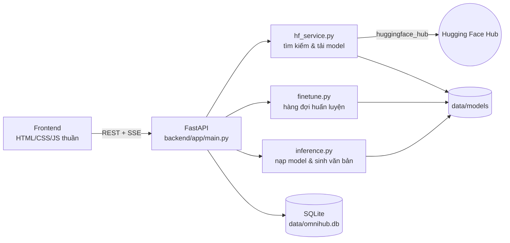

# OmniHub NLP

Hệ thống tải, quản lý, **chat** và **fine-tune** các model NLP từ [Hugging Face Hub](https://huggingface.co/models) — chạy hoàn toàn trên máy cục bộ hoặc server riêng.

- Tìm kiếm & tải model NLP từ Hugging Face (11 nhóm tác vụ)
- Chat với model (streaming), lưu & tìm kiếm lịch sử hội thoại
- Fine-tune model với dataset riêng hoặc dataset trên Hub (hỗ trợ LoRA)
- Giao diện responsive (desktop / tablet / mobile), dark mode
- Triển khai bằng Docker (CPU hoặc GPU NVIDIA)

---

## Mục lục

1. [Kiến trúc](#kiến-trúc)
2. [Yêu cầu hệ thống](#yêu-cầu-hệ-thống)
3. [Cài đặt & chạy](#cài-đặt--chạy)
4. [Hướng dẫn sử dụng](#hướng-dẫn-sử-dụng)
5. [Định dạng dataset cho fine-tune](#định-dạng-dataset-cho-fine-tune)
6. [Model gợi ý](#model-gợi-ý)
7. [Cấu hình](#cấu-hình)
8. [REST API](#rest-api)
9. [Cấu trúc thư mục](#cấu-trúc-thư-mục)
10. [Bảo mật](#bảo-mật)
11. [Xử lý sự cố](#xử-lý-sự-cố)

---

## Kiến trúc



| Thành phần | Công nghệ |
|---|---|
| Backend | FastAPI, Uvicorn |
| ML | PyTorch, Transformers 5.x, Datasets, PEFT (LoRA), Accelerate |
| Hub | huggingface_hub 1.x |
| Lưu trữ | SQLite (model, hội thoại, tin nhắn, job, cài đặt) + file trên đĩa |
| Frontend | HTML/CSS/JS thuần (ES modules), không cần build |

Một số đặc điểm thiết kế:

- **Chỉ giữ 1 model trong bộ nhớ** tại một thời điểm để tiết kiệm RAM/VRAM. Đổi model sẽ tự giải phóng model cũ.
- **Fine-tune chạy tuần tự** qua một hàng đợi nền; khi bắt đầu huấn luyện, model chat đang nạp sẽ được giải phóng.
- **Chat dùng Server-Sent Events** để hiển thị token theo thời gian thực; câu trả lời được lưu vào DB khi kết thúc (kể cả khi bấm dừng).
- Vì trạng thái nằm trong tiến trình, server **phải chạy 1 worker**.

---

## Yêu cầu hệ thống

| | Tối thiểu | Khuyến nghị |
|---|---|---|
| Python | 3.11+ (đã thử với 3.12, 3.13) | 3.12 |
| RAM | 4 GB | 16 GB+ |
| Ổ đĩa | 5 GB trống | 50 GB+ (mỗi model 0.5 – 15 GB) |
| GPU | Không bắt buộc | NVIDIA có CUDA (tự động phát hiện) |

> Trên CPU nên dùng model ≤ 1.5B tham số để chat, ≤ 0.5B (hoặc bật LoRA) để fine-tune.

---

## Cài đặt & chạy

### Cách 1 — Chạy trực tiếp (Windows)

```powershell
cd c:\onmi-hub
.\run.ps1
```

Lần đầu script sẽ tạo `.venv` và cài toàn bộ thư viện (PyTorch khá nặng). Sau đó mở: **http://127.0.0.1:8000**

### Cách 2 — Chạy thủ công (Windows / Linux / macOS)

```bash
python -m venv .venv
# Windows: .venv\Scripts\activate   |   Linux/macOS: source .venv/bin/activate
pip install -r backend/requirements.txt

cd backend
uvicorn app.main:app --host 127.0.0.1 --port 8000
```

> Có GPU NVIDIA? Cài PyTorch bản CUDA trước theo hướng dẫn tại https://pytorch.org/get-started/locally/ rồi mới cài `requirements.txt`.

### Cách 3 — Docker

Yêu cầu Docker Desktop / Docker Engine đang chạy.

```bash
docker compose up -d --build
docker compose logs -f
```

Mở **http://127.0.0.1:8000**. Dữ liệu được lưu trong volume `omnihub-data` (không mất khi xoá container).

**Với GPU NVIDIA** (cần NVIDIA Container Toolkit):

```powershell
$env:TORCH_INDEX_URL="https://download.pytorch.org/whl/cu124"
docker compose -f docker-compose.yml -f docker-compose.gpu.yml up -d --build
```

Các lệnh hữu ích:

```bash
docker compose down                 # dừng
docker compose up -d --build        # cập nhật sau khi sửa code
docker volume inspect onmi-hub_omnihub-data   # xem nơi lưu dữ liệu
```

---

## Hướng dẫn sử dụng

### 1. Model Hub — tìm & tải model

1. Vào **Model Hub**.
2. Nhập từ khoá (vd: `Qwen2.5 Instruct`, `phobert`, `vit5`), chọn **tác vụ** và **cách sắp xếp** (lượt tải, lượt thích, xu hướng, mới cập nhật).
3. Bấm **Chi tiết** để xem dung lượng tải, số tham số, license, ngôn ngữ, danh sách file.
4. Bấm **Tải về**. Quá trình tải chạy nền, theo dõi tại **Model của tôi**.

Các tác vụ NLP được hỗ trợ:

| Tác vụ | Chat được? | Fine-tune được? |
|---|---|---|
| `text-generation` (Sinh văn bản) | ✅ hội thoại nhiều lượt | ✅ Causal LM |
| `text2text-generation`, `summarization`, `translation` | ✅ (dùng tin nhắn cuối) | ✅ Seq2Seq |
| `text-classification` | ✅ hiển thị nhãn + xác suất | ✅ Phân loại |
| `token-classification` (NER) | ✅ hiển thị thực thể | – |
| `question-answering` | ✅ | – |
| `fill-mask` | ✅ | – |
| `zero-shot-classification` | ✅ | – |
| `sentence-similarity`, `feature-extraction` | ✅ | – |

> Chỉ các model có định dạng PyTorch/Safetensors cho thư viện `transformers` mới được liệt kê. File ONNX, TF, Flax, GGUF... được bỏ qua khi tải để tiết kiệm dung lượng.

**Model gated** (Llama, Gemma...): chấp nhận điều khoản trên trang model của Hugging Face, sau đó nhập token tại **Cài đặt**.

### 2. Model của tôi

- Lọc theo **Tất cả / Từ Hub / Fine-tuned**.
- Theo dõi tiến độ tải (%), dung lượng, kiến trúc model.
- Hành động: **Chat**, **Fine-tune** (mở form với model này làm model gốc), **Thử lại** (khi tải lỗi), **Xoá**.

### 3. Chat

- Chọn model ở thanh trên cùng (nhóm theo tác vụ; model fine-tune có dấu ★).
- **Enter** để gửi, **Shift + Enter** để xuống dòng. Bấm nút ■ để dừng sinh.
- Biểu tượng ⚙ (thanh trượt) mở bảng tham số:

| Tham số | Ý nghĩa | Gợi ý |
|---|---|---|
| System prompt | Chỉ dẫn vai trò cho model | "Bạn là trợ lý AI trả lời bằng tiếng Việt." |
| Temperature | Độ sáng tạo (0 = luôn chọn từ xác suất cao nhất) | 0.6 – 0.8 |
| Top-p | Lấy mẫu nucleus | 0.9 |
| Max tokens | Độ dài tối đa câu trả lời | 256 – 512 trên CPU |
| Repetition penalty | Phạt lặp từ | 1.1 |

- Tham số được lưu trong trình duyệt; system prompt & model được lưu theo từng hội thoại.
- Dưới mỗi tin nhắn: **Sao chép**, **Tạo lại** (cho câu trả lời cuối).
- Lịch sử dài sẽ được tự động cắt bớt các lượt cũ nhất để vừa context của model.

**Lịch sử hội thoại** (panel bên trái, trên mobile bấm biểu tượng đồng hồ):

- Tự động đặt tiêu đề theo tin nhắn đầu tiên; nhóm theo Hôm nay / Hôm qua / 7 ngày / 30 ngày.
- Tìm kiếm theo tiêu đề và nội dung tin nhắn.
- Đổi tên, xoá từng hội thoại hoặc xoá toàn bộ.

**Định dạng nhập cho model không phải sinh văn bản** (dùng dòng `---` làm phân cách):

| Tác vụ | Cách nhập |
|---|---|
| Hỏi đáp | `câu hỏi` ↵ `---` ↵ `đoạn ngữ cảnh` |
| Zero-shot | `văn bản` ↵ `---` ↵ `nhãn1, nhãn2, nhãn3` |
| Fill-mask | Câu có chứa `[MASK]` (hoặc `<mask>`) |
| Độ tương đồng câu | `câu A` ↵ `---` ↵ `câu B` (nhập 1 câu → trả về vector) |

### 4. Fine-tuning

**Bước 1 — Model & tác vụ**

- **Model gốc**: model đã tải xong (có thể là model đã fine-tune trước đó).
- **Loại fine-tune**: tự chọn theo tác vụ của model, có thể đổi:
  - *Causal LM* — model sinh văn bản/chat (GPT, Llama, Qwen, SmolLM...)
  - *Seq2Seq* — T5, BART, mT5, ViT5... (tóm tắt, dịch)
  - *Phân loại văn bản* — BERT, PhoBERT, RoBERTa... (đầu phân loại được tạo mới theo số nhãn)
- **Tên model đầu ra**: chữ, số, `.`, `-`, `_`.

**Bước 2 — Dataset**

- *Tải file lên*: kéo thả `.csv`, `.json`, `.jsonl`, `.txt` (tối đa 200 MB, cấu hình được) hoặc chọn file đã tải trước.
- *Hugging Face Dataset*: nhập tên (vd `imdb`, `tatsu-lab/alpaca`), config (nếu có), split → **Xem trước**.

**Bước 3 — Ánh xạ cột**: hệ thống tự đoán cột dựa theo tên, có thể sửa lại (xem [định dạng dataset](#định-dạng-dataset-cho-fine-tune)).

**Bước 4 — Siêu tham số**

| Tham số | Mặc định | Ghi chú |
|---|---|---|
| Epochs | 3 | Số lượt duyệt dữ liệu |
| Learning rate | 5e-5 | LoRA thường dùng 1e-4 – 3e-4 |
| Batch size | 4 | Giảm nếu thiếu bộ nhớ |
| Grad. accumulation | 1 | Batch hiệu dụng = batch size × giá trị này |
| Max length | 512 | Số token tối đa mỗi mẫu |
| Warmup ratio | 0.05 | Tỉ lệ bước khởi động LR (0 – 0.99) |
| Weight decay | 0 | |
| Tỉ lệ eval | 0.1 | Tách tập đánh giá (0 = không đánh giá) |
| Giới hạn mẫu | 0 | 0 = dùng toàn bộ; đặt nhỏ để thử nhanh |
| LoRA | tắt | Chỉ huấn luyện adapter nhỏ → nhanh & ít bộ nhớ; adapter được **merge** vào model khi lưu |
| LoRA r / alpha / dropout | 8 / 16 / 0.05 | |

**Theo dõi job** (cột bên phải): trạng thái, % tiến độ, epoch, loss train / eval, biểu đồ loss (đường liền = train, đường đứt = eval), nhật ký chi tiết. Có thể **Huỷ** job đang chạy/đang chờ. Khi hoàn tất, bấm **Chat** để thử ngay model mới.

> Trên GPU, hệ thống tự bật `bf16` (nếu GPU hỗ trợ) hoặc `fp16`.

### 5. Cài đặt

- **Hugging Face Token**: lưu trong DB cục bộ, chỉ hiển thị 4 ký tự cuối. Có thể dùng biến môi trường `HF_TOKEN` thay thế.
- **Giao diện**: Sáng / Tối / Theo hệ thống (cũng có thể bấm nút mặt trăng/mặt trời ở sidebar hoặc topbar trên mobile).
- **Hệ thống**: thiết bị (CPU/CUDA/MPS), phiên bản PyTorch, model đang nạp, tổng dung lượng model; nút **Giải phóng model khỏi bộ nhớ**.

---

## Định dạng dataset cho fine-tune

### Causal LM — văn bản thuần (cột `text`)

```csv
text
"Hà Nội là thủ đô của Việt Nam."
"Phở là món ăn truyền thống nổi tiếng."
```

File `.txt`: mỗi dòng là một mẫu (tự động thành cột `text`).

### Causal LM — dạng hỏi/đáp (cột `prompt` + `response`)

```jsonl
{"instruction": "Thủ đô của Việt Nam là gì?", "output": "Thủ đô của Việt Nam là Hà Nội."}
{"instruction": "Dịch sang tiếng Anh: Xin chào", "output": "Hello"}
```

Nếu tokenizer có chat template, mỗi mẫu được định dạng theo template của model (user → assistant), nên model sau fine-tune chat đúng định dạng. Nếu không, dùng mẫu `User: ...\nAssistant: ...`.

### Seq2Seq (cột `input` + `target`)

```json
[
  {"document": "Bài báo dài ...", "summary": "Tóm tắt ngắn ..."},
  {"document": "...", "summary": "..."}
]
```

### Phân loại văn bản (cột `text` + `label`)

```csv
text,label
"Sản phẩm rất tốt, giao hàng nhanh",positive
"Chất lượng kém, không như mô tả",negative
```

Nhãn có thể là chuỗi hoặc số; cần ít nhất 2 nhãn khác nhau. Tên nhãn được lưu vào config của model và hiển thị khi chat.

> Lưu ý file CSV: giá trị có dấu phẩy phải đặt trong dấu ngoặc kép. File nên mã hoá UTF-8.

---

## Model gợi ý

**Chat trên CPU:**

| Model | Dung lượng | Ghi chú |
|---|---|---|
| `Qwen/Qwen2.5-0.5B-Instruct` | ~1 GB | Nhanh, tiếng Việt khá — khuyến nghị bắt đầu |
| `Qwen/Qwen2.5-1.5B-Instruct` | ~3 GB | Chất lượng tốt hơn |
| `HuggingFaceTB/SmolLM2-360M-Instruct` | ~0.7 GB | Rất nhẹ, chủ yếu tiếng Anh |
| `TinyLlama/TinyLlama-1.1B-Chat-v1.0` | ~2.2 GB | Tiếng Anh |

**Fine-tune / tác vụ khác:**

| Mục đích | Model |
|---|---|
| Phân loại tiếng Việt | `vinai/phobert-base`, `xlm-roberta-base` |
| Tóm tắt / sinh tiếng Việt | `VietAI/vit5-base` |
| Thử nghiệm nhanh pipeline | `sshleifer/tiny-gpt2` (model ngẫu nhiên, chỉ để test) |

---

## Cấu hình

Biến môi trường:

| Biến | Mặc định | Mô tả |
|---|---|---|
| `OMNI_DATA_DIR` | `./data` (`/data` trong Docker) | Thư mục chứa DB, model, dataset |
| `OMNI_MAX_UPLOAD_MB` | `200` | Dung lượng tối đa file dataset tải lên |
| `HF_TOKEN` | – | Token Hugging Face (token lưu trong **Cài đặt** được ưu tiên) |
| `HF_HOME` | mặc định của HF (`/data/hf-cache` trong Docker) | Cache của Hugging Face (dataset Hub...) |

Biến cho Docker Compose:

| Biến | Mặc định | Mô tả |
|---|---|---|
| `OMNI_BIND` | `127.0.0.1` | Địa chỉ host để publish cổng |
| `OMNI_PORT` | `8000` | Cổng trên host |
| `TORCH_INDEX_URL` | CPU wheels | Đổi sang `.../whl/cu124` để build bản GPU |

---

## REST API

Tài liệu tương tác (Swagger) có sẵn tại **http://127.0.0.1:8000/docs**.

| Method | Endpoint | Mô tả |
|---|---|---|
| GET | `/api/system` | Thiết bị, danh sách tác vụ, model đang nạp |
| GET / PUT | `/api/settings` | Xem / cập nhật HF token |
| GET | `/api/hub/models?q=&task=&sort=&limit=` | Tìm model trên Hub |
| GET | `/api/hub/models/{repo_id}` | Chi tiết model trên Hub |
| POST | `/api/models/download` | `{ "repo_id": "Qwen/Qwen2.5-0.5B-Instruct" }` |
| GET | `/api/models` | Danh sách model cục bộ (kèm tiến độ tải) |
| DELETE | `/api/models/{id}` | Xoá model |
| POST | `/api/models/unload` | Giải phóng model khỏi bộ nhớ |
| GET | `/api/conversations?q=` | Danh sách / tìm kiếm hội thoại |
| POST | `/api/conversations` | `{ model_id, title?, system_prompt? }` |
| GET / PATCH / DELETE | `/api/conversations/{id}` | Xem (kèm tin nhắn) / sửa / xoá |
| DELETE | `/api/conversations` | Xoá toàn bộ lịch sử |
| POST | `/api/conversations/{id}/messages` | Gửi tin nhắn, trả về **SSE stream** |
| GET | `/api/datasets` | Dataset đã tải lên |
| POST | `/api/datasets/upload` | Upload (multipart, field `file`) |
| DELETE | `/api/datasets/{id}` | Xoá dataset |
| POST | `/api/datasets/hub-preview` | `{ name, config?, split }` |
| GET / POST | `/api/finetune/jobs` | Danh sách / tạo job |
| GET / DELETE | `/api/finetune/jobs/{id}` | Chi tiết / xoá job |
| POST | `/api/finetune/jobs/{id}/cancel` | Huỷ job |

**Ví dụ gửi tin nhắn:**

```bash
curl -N -X POST http://127.0.0.1:8000/api/conversations/1/messages \
  -H "Content-Type: application/json" \
  -d '{"content": "Xin chào!", "params": {"temperature": 0.7, "max_new_tokens": 256}}'
```

Luồng trả về:

```
data: {"type": "start", "model": "Qwen__Qwen2.5-0.5B-Instruct"}
data: {"type": "token", "text": "Xin"}
data: {"type": "token", "text": " chào"}
...
data: {"type": "done", "message_id": 42}
```

Gửi `"regenerate": true` để xoá câu trả lời cuối và sinh lại.

**Ví dụ tạo job fine-tune:**

```json
POST /api/finetune/jobs
{
  "base_model": "Qwen__Qwen2.5-0.5B-Instruct",
  "task": "causal-lm",
  "output_name": "qwen-0.5b-support",
  "dataset": { "source": "upload", "file_id": "<id trả về từ upload>" },
  "columns": { "prompt": "instruction", "response": "output" },
  "params": { "epochs": 2, "learning_rate": 0.0002, "batch_size": 4, "max_length": 512, "use_lora": true }
}
```

`task`: `causal-lm` | `seq2seq` | `classification`. Cột cần thiết: `text` hoặc `prompt`+`response` (causal-lm), `input`+`target` (seq2seq), `text`+`label` (classification).

---

## Cấu trúc thư mục

```
onmi-hub/
├── backend/
│   ├── app/
│   │   ├── main.py          # FastAPI routes, SSE chat, phục vụ frontend
│   │   ├── config.py        # Đường dẫn, danh sách tác vụ NLP
│   │   ├── database.py      # SQLite schema & helper
│   │   ├── hf_service.py    # Tìm kiếm / tải / quản lý model
│   │   ├── inference.py     # Nạp model, streaming generation, pipeline
│   │   └── finetune.py      # Dataset, hàng đợi & huấn luyện (Trainer, LoRA)
│   └── requirements.txt
├── frontend/
│   ├── index.html
│   ├── css/styles.css       # Theme sáng/tối, responsive
│   └── js/
│       ├── app.js           # Router, khởi tạo
│       ├── api.js           # fetch + đọc SSE
│       ├── state.js         # Store danh sách model
│       ├── ui.js            # Toast, modal, theme, markdown an toàn
│       ├── chat.js | hub.js | models.js | finetune.js | settings.js
├── data/                    # (tạo tự động, không commit)
│   ├── omnihub.db
│   ├── models/<tên_model>/  # repo "org/name" lưu thành "org__name"
│   ├── datasets/
│   └── jobs/                # checkpoint tạm khi huấn luyện
├── Dockerfile
├── docker-compose.yml
├── docker-compose.gpu.yml
└── run.ps1
```

---

## Bảo mật

- **Không có xác thực người dùng.** Mặc định server chỉ lắng nghe trên `127.0.0.1`. Nếu cần truy cập từ máy khác, hãy đặt sau reverse proxy có xác thực (Nginx/Caddy + basic auth hoặc SSO) và HTTPS — **không** publish trực tiếp `0.0.0.0` ra Internet.
- `trust_remote_code` luôn **tắt**: model yêu cầu code tuỳ biến sẽ không nạp được (tránh thực thi code lạ).
- Repo ID, tên model, tên file dataset đều được kiểm tra để chống path traversal; file upload được đổi tên ngẫu nhiên và giới hạn dung lượng.
- HF token chỉ lưu cục bộ trong SQLite và không bao giờ trả nguyên văn về giao diện.
- Nội dung chat được escape trước khi hiển thị (markdown chỉ hỗ trợ tập con an toàn, không render HTML/link).

---

## Xử lý sự cố

| Vấn đề | Cách xử lý |
|---|---|
| Tìm kiếm Hub lỗi / timeout | Kiểm tra kết nối Internet, proxy; model gated cần token |
| Tải model báo lỗi 401/403 | Model gated/private → chấp nhận điều khoản trên Hugging Face và nhập token |
| "Tải xuống bị gián đoạn" | Server bị tắt khi đang tải → bấm **Thử lại** |
| Hết RAM khi chat | Dùng model nhỏ hơn, giảm Max tokens, bấm **Giải phóng model** |
| Hết RAM/VRAM khi fine-tune | Bật LoRA, giảm batch size (tăng grad. accumulation), giảm max length, đặt giới hạn mẫu |
| Model trả lời lặp / vô nghĩa | Dùng model *Instruct/Chat*, tăng repetition penalty, giảm temperature |
| Không nạp được model ("trust_remote_code") | Model yêu cầu code tuỳ biến — chọn model khác |
| Dataset báo thiếu cột | Kiểm tra lại ánh xạ cột ở bước 3; CSV có BOM/dấu phẩy phải đúng định dạng |
| Job ở trạng thái "Server khởi động lại" | Server tắt khi đang huấn luyện → tạo lại job |
| Cổng 8000 đã bị dùng | Đổi cổng: `uvicorn ... --port 8001` hoặc `OMNI_PORT=8001` với Docker |
| Docker: `error during connect` | Docker Desktop chưa chạy |
| Giao diện không cập nhật sau khi sửa | Tải lại trang bằng Ctrl + F5 để bỏ cache |
